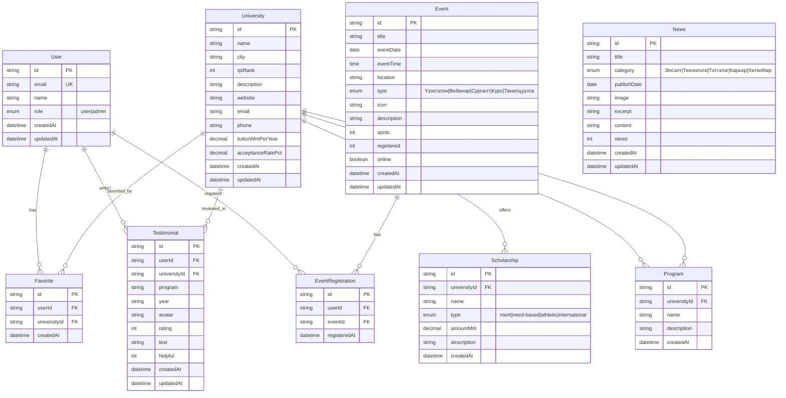

# ERD Diagram - Edu Portal System

## Системийн Entity Relationship Diagram

Энэ диаграм нь Edu Portal системийн өгөгдлийн бүтцийг харуулна.

---

## Mermaid ERD Diagram

---

## Entity Тайлбар

### 1. User (Хэрэглэгч)
- Системийн хэрэглэгчдийн мэдээлэл
- **Түлхүүр талбар**: `id` (Primary Key), `email` (Unique)
- **Хамаарал**: Favorite, Testimonial, EventRegistration-тай холбогддог

### 2. University (Их Сургууль)
- Их сургуулийн үндсэн мэдээлэл
- **Түлхүүр талбар**: `id` (Primary Key)
- **Хамаарал**: Scholarship, Program, Favorite, Testimonial-тай холбогддог

### 3. Scholarship (Тэтгэлэг)
- Их сургуулийн тэтгэлгийн мэдээлэл
- **Түлхүүр талбар**: `id` (Primary Key)
- **Хамаарал**: University-тай Many-to-One (олон тэтгэлэг нэг их сургуульд)

### 4. Program (Хөтөлбөр)
- Их сургуулийн хөтөлбөрийн мэдээлэл
- **Түлхүүр талбар**: `id` (Primary Key)
- **Хамаарал**: University-тай Many-to-One (олон хөтөлбөр нэг их сургуульд)

### 5. Event (Үйл явдал)
- Их сургуулийн үйл явдлууд (үзэсгэлэн, вебинар, сургалт гэх мэт)
- **Түлхүүр талбар**: `id` (Primary Key)
- **Хамаарал**: EventRegistration-тай One-to-Many

### 6. EventRegistration (Үйл явдалд бүртгэл)
- Хэрэглэгчдийн үйл явдалд бүртгүүлэх мэдээлэл
- **Түлхүүр талбар**: `id` (Primary Key)
- **Хамаарал**: User болон Event-тай Many-to-One

### 7. Testimonial (Сэтгэгдэл)
- Хэрэглэгчдийн их сургуулийн талаарх сэтгэгдэл
- **Түлхүүр талбар**: `id` (Primary Key)
- **Хамаарал**: User болон University-тай Many-to-One

### 8. News (Мэдээ)
- Системийн мэдээ, мэдээлэл
- **Түлхүүр талбар**: `id` (Primary Key)
- **Хамаарал**: Тусдаа entity (өөрийн гэсэн бүтэцтэй)

### 9. Favorite (Дуртай)
- Хэрэглэгчдийн дуртай их сургуулиуд
- **Түлхүүр талбар**: `id` (Primary Key)
- **Хамаарал**: User болон University-тай Many-to-Many (Junction Table)

---

## Хамаарлын Тайлбар

1. **User ↔ Favorite ↔ University**: Олон-олон хамаарал
   - Нэг хэрэглэгч олон их сургууль дуртай болгож болно
   - Нэг их сургууль олон хэрэглэгчдийн дуртай байж болно

2. **User → Testimonial**: Нэг-олон хамаарал
   - Нэг хэрэглэгч олон сэтгэгдэл үлдээж болно

3. **University → Testimonial**: Нэг-олон хамаарал
   - Нэг их сургуульд олон сэтгэгдэл байж болно

4. **University → Scholarship**: Нэг-олон хамаарал
   - Нэг их сургууль олон тэтгэлэг санал болгож болно

5. **University → Program**: Нэг-олон хамаарал
   - Нэг их сургууль олон хөтөлбөртэй байж болно

6. **User → EventRegistration**: Нэг-олон хамаарал
   - Нэг хэрэглэгч олон үйл явдалд бүртгүүлж болно

7. **Event → EventRegistration**: Нэг-олон хамаарал
   - Нэг үйл явдалд олон хэрэглэгч бүртгүүлж болно

---

## Түлхүүр Тэмдэглэгээ

- **PK**: Primary Key (Үндсэн түлхүүр)
- **FK**: Foreign Key (Гадаад түлхүүр)
- **UK**: Unique Key (Өвөрмөц түлхүүр)

---

## Диаграмыг Хэрхэн Ашиглах

1. **Mermaid диаграм**: GitHub, GitLab, Notion зэрэг платформууд дээр шууд харагдана
2. **Draw.io**: Mermaid диаграмыг Draw.io руу экспорт хийж болно
3. **Online Viewer**: [Mermaid Live Editor](https://mermaid.live/) дээр диаграмыг харах, засах боломжтой

---

*Энэ диаграм нь Edu Portal системийн одоогийн бүтцийг илэрхийлнэ. Ирээдүйд өргөтгөл хийх боломжтой.*

